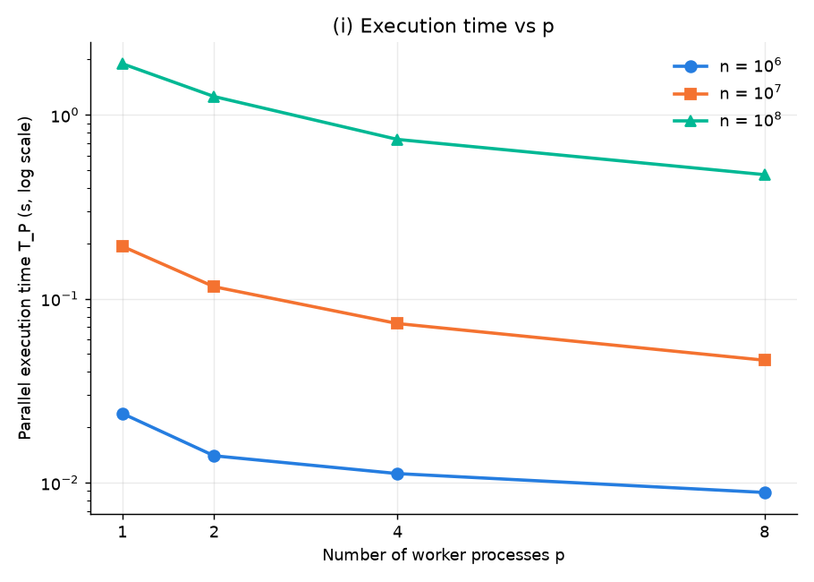
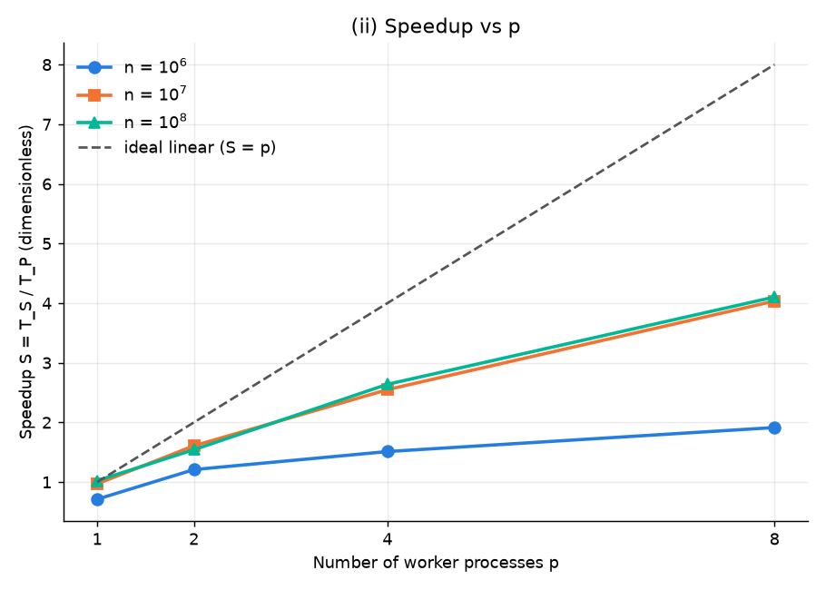
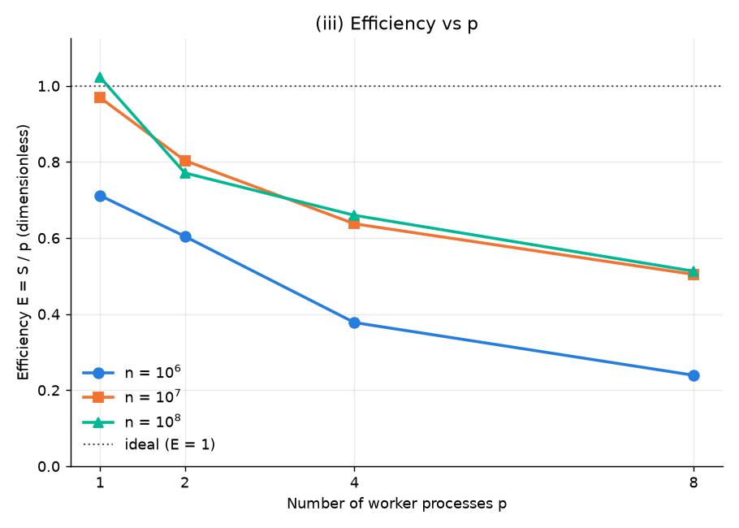
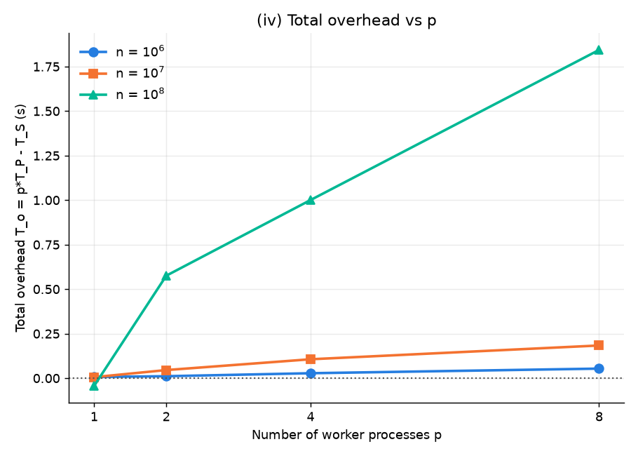
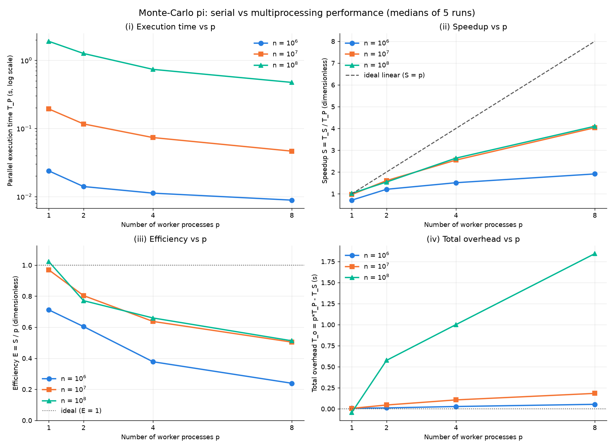

# PDC Assignment 4 – Q3: Parallel Performance Analyzer

**Roll No:** 23F-0506  **Course:** Parallel & Distributed Computing (Chapter 6 – Message-Passing Paradigm)

This project measures how well a simple data-parallel program scales. It runs the same
workload serially and in parallel, computes the standard PDC performance metrics from the
timings, and plots them automatically.

**Chosen workload: Option 3 – Monte-Carlo estimation of π with *n* samples.**
Throw *n* random points into the unit square and count the *hits* inside the quarter circle
x² + y² ≤ 1, then π ≈ 4 · hits / n.

| Part | File | What it does |
|---|---|---|
| A | [src/pi_serial.py](src/pi_serial.py) | Fastest single-core version I could write (gives **T_S**): blocked, in-place float32 numpy kernel |
| A | [src/pi_parallel.py](src/pi_parallel.py) | `multiprocessing.Pool` with *p* workers: split *n* into *p* parts → each worker runs the same kernel with its own `SeedSequence` stream → parent sums the hits (reduction) |
| A | [src/main.py](src/main.py) | Benchmark driver: n ∈ {10⁶, 10⁷, 10⁸}, p ∈ {1, 2, 4, 8}, 5 runs each → `results/raw_timings.csv`; then runs Part B and C |
| B | [src/metrics.py](src/metrics.py) | Speedup, efficiency, cost, total overhead, serial fraction → `results/metrics.csv` + terminal table + bonus iso-efficiency estimate |
| C | [src/plot.py](src/plot.py) | Time, speedup (with ideal line), efficiency, overhead plots and a 2×2 dashboard → `figures/` |

```
PDC-A4-23F_0506/
├── src/
│   ├── main.py          ← runs everything end-to-end
│   ├── pi_serial.py
│   ├── pi_parallel.py
│   ├── metrics.py
│   └── plot.py
├── results/
│   ├── raw_timings.csv  ← workload, n, p, run, time_sec (every single run)
│   ├── metrics.csv      ← one row per (n, p)
│   ├── pool_startup.csv ← worker start-up time per p (extra overhead, not in T_P)
│   └── run_log.txt      ← full terminal output of the run below
├── figures/             ← all generated plots
├── README.md
├── requirements.txt
└── .gitignore
```

## Machine specs

| | |
|---|---|
| CPU | 11th Gen Intel Core i7-1165G7 @ 2.80 GHz (turbo up to 4.7 GHz) |
| Cores / threads | 4 physical cores / 8 logical threads (Hyper-Threading) |
| RAM | 16 GB |
| OS | Windows 11 Pro (build 26300), 64-bit |
| Software | Python 3.12.10, numpy 2.5.2, pandas 3.1.1, matplotlib 3.11.1 |
| Conditions | Laptop on battery, *Balanced* power plan, no other heavy programs open |

## How to install and run

```bash
pip install -r requirements.txt
python src/main.py
```

That one command runs the full benchmark (about 40 s on the machine above, plus a few seconds for metrics and plots), writes
`results/raw_timings.csv` and `results/metrics.csv`, prints the metrics table and saves all
figures in `figures/`. The parts can also be re-run on their own:
`python src/metrics.py` (from an existing `raw_timings.csv`) and `python src/plot.py`
(from an existing `metrics.csv`). For a quick test:
`python src/main.py --runs 2 --sizes 1000000 10000000 --procs 1 2`.

### Measurement method

* **T_S** = median of 5 runs of the serial program; **T_P** = median of 5 runs of the parallel program.
* **Serial kernel tuning.** float32 numbers, x and y drawn with one generator call, 64K-point
  blocks (the 512 KB buffer stays in L2 cache), preallocated buffers and in-place ops. On the
  same laptop this was about 3× faster than a naive float64 numpy version.
* **Pool start-up is kept out of T_P.** On Windows `multiprocessing` uses *spawn*, so every
  worker is a new Python interpreter that imports numpy again. The pool for each *p* is
  started once before timing, the same way `mpiexec` starts MPI ranks once. T_P covers
  distribute → compute → reduce. The start-up cost is in `results/pool_startup.csv`:
  0.60 s (p=1), 0.76 s (p=2), 0.92 s (p=4), 1.10 s (p=8).
* **Interleaved rounds.** Each round times every serial *n* and every (n, p) once, so a change
  in CPU clock during the benchmark (turbo, heat, battery) affects all configurations the
  same way.

## Results

Terminal output of `python src/main.py` (all times in seconds; f is the experimentally
determined serial fraction, which is undefined for p = 1):

```
Performance metrics (T_S and T_P are medians of the runs)
------------------------------------------------------------------------------------------
            n   p    T_S (s)    T_P (s)  Speedup  Effic.   Cost (s)    T_o (s)  f (Amdahl)
------------------------------------------------------------------------------------------
    1,000,000   1     0.0169     0.0238    0.712   0.712     0.0238     0.0068           -
    1,000,000   2     0.0169     0.0140    1.209   0.604     0.0280     0.0111      0.6544
    1,000,000   4     0.0169     0.0112    1.511   0.378     0.0448     0.0279      0.5489
    1,000,000   8     0.0169     0.0088    1.914   0.239     0.0707     0.0538      0.4542
------------------------------------------------------------------------------------------
   10,000,000   1     0.1869     0.1928    0.969   0.969     0.1928     0.0059           -
   10,000,000   2     0.1869     0.1162    1.608   0.804     0.2325     0.0456      0.2441
   10,000,000   4     0.1869     0.0733    2.550   0.637     0.2931     0.1063      0.1896
   10,000,000   8     0.1869     0.0463    4.035   0.504     0.3705     0.1836      0.1404
------------------------------------------------------------------------------------------
  100,000,000   1     1.9400     1.8969    1.023   1.023     1.8969    -0.0430           -
  100,000,000   2     1.9400     1.2578    1.542   0.771     2.5156     0.5756      0.2967
  100,000,000   4     1.9400     0.7351    2.639   0.660     2.9404     1.0004      0.1719
  100,000,000   8     1.9400     0.4729    4.102   0.513     3.7833     1.8433      0.1357
------------------------------------------------------------------------------------------

Bonus - problem size needed to keep E >= 0.6 as p doubles
  model:  T_S(n) ~ -2.271e-03 + 1.917e-08*n s,   T_o(n,p) ~ a_p + b_p*n s
  p=2: measured E >= 0.6 first at n = 1,000,000
  p=4: measured E >= 0.6 first at n = 10,000,000
  p=8: measured E >= 0.6 first at n = none of the measured sizes
  p=2: a_p=6.02e-03 s, b_p=4.67e-09 s/sample, E_inf=0.80  ->  n >= 929,057
  p=4: a_p=1.81e-02 s, b_p=9.37e-09 s/sample, E_inf=0.67  ->  n >= 5,768,376   (6.2x the size needed at p=2)
  p=8: a_p=3.60e-02 s, b_p=1.65e-08 s/sample, E_inf=0.54  ->  not reachable - E_inf = 0.54 < 0.6, overhead grows as fast as the work
```

**How the bonus is estimated.** E = T_S / (T_S + T_o), so E ≥ 0.6 ⇔ T_o ≤ (2/3)·T_S.
Straight lines T_S(n) ≈ c₀ + c₁n and T_o(n, p) ≈ a_p + b_p·n are fitted to the measured
data, and the inequality is solved for *n*. *a_p* is the fixed cost of one parallel job
(sending tasks, collecting results), and *b_p* is overhead that grows with the work.
E_inf = c₁ / (c₁ + b_p) is the best efficiency possible at that *p*, however large *n* is.

## Figures

### (i) Execution time vs p


### (ii) Speedup vs p (dashed = ideal linear speedup)


### (iii) Efficiency vs p


### (iv) Total overhead vs p


### (v) Dashboard


## Analysis

Monte-Carlo π is close to *embarrassingly parallel*. Each worker gets an independent block
of samples, and the only interaction is one scatter of (n_part, seed) and one sum-reduction
of *p* integers. In theory the speedup should be almost linear. The measured speedup is
sub-linear: at p = 8 it reaches 4.10 for n = 10⁸ and 4.03 for n = 10⁷, which is an
efficiency of about 0.51. The reasons show up clearly in the overhead and efficiency plots.

**Overhead sources.**
1. **Fixed per-job overhead.** Every parallel call pickles the tasks, wakes *p* processes
   through pipes, and collects and sums the results. This is a few milliseconds and grows
   with *p* (a_p ≈ 6 ms → 18 ms → 36 ms). For n = 10⁶ the whole serial job takes only 17 ms,
   so this fixed cost dominates. Even p = 1 is slower than serial (E = 0.71), and efficiency
   falls to 0.24 at p = 8.
2. **Hardware sharing.** The CPU has only 4 physical cores. Going from p = 4 to p = 8 uses
   Hyper-Threading, where two workers share one core's execution units. That still gives
   about 1.55× more speedup (2.64 → 4.10), but each worker runs slower. All workers also
   share the L3 cache, memory bandwidth and the power budget. With more cores busy,
   turbo boost drops the clock, which is why E falls to about 0.77 already at p = 2 for the
   largest *n*. This overhead grows with *n* (the b_p·n term), so T_o for n = 10⁸ rises
   almost linearly with *p* (0.58 s → 1.00 s → 1.84 s) instead of staying constant.
3. **Process start-up** (0.6–1.1 s, measured separately). This is longer than the whole
   n = 10⁷ run. It is a one-time cost, but a real program that runs only once would pay it.

**Efficiency trends and scalability.** For a fixed *p*, efficiency rises with problem size
because the fixed overhead is spread over more work (p = 4: 0.38 → 0.64 → 0.66). The
n = 10⁷ and 10⁸ curves almost overlap, so above about 10⁷ samples the fixed overhead no longer
matters and the hardware limits take over. For a fixed *n*, efficiency always falls as *p*
grows, which is typical of a program that is not perfectly scalable. The iso-efficiency
estimate puts numbers on this. To keep E ≥ 0.6, *n* has to grow about 6× when *p* goes
from 2 to 4. At p = 8 the target cannot be reached on this laptop for any *n*
(E_inf ≈ 0.54), because Hyper-Threaded workers cannot each run at full single-core speed.

**What the speedup curve says about the parallel fraction.** The experimentally
determined serial fraction (Karp–Flatt) for n = 10⁸ is f ≈ 0.30, 0.17, 0.14 for p = 2, 4, 8.
If the program really had a 14 % serial part, Amdahl's law would cap the speedup at
1/f ≈ 7.4. In this code the truly serial work is almost nothing: splitting *n*, spawning seeds
and adding *p* integers. So the inherent parallel fraction is over 99 %. The fact that f falls
as *p* grows (instead of staying constant or rising) shows that the loss is not a fixed
serial part or growing communication. It is mostly a fixed hardware penalty from shared
clock, cache and cores that shows up as soon as more than one core is active. For small
*n* (f ≈ 0.45–0.65) the fixed per-job overhead acts like a large serial fraction. In short,
the algorithm scales almost perfectly, and the limits here come from the platform
(4 cores, Hyper-Threading, process-based parallelism on Windows), not from the
decomposition.

**Notes on the data.** The laptop was on battery, so absolute times are about 5× slower
than when plugged in (n = 10⁷ took ~0.04 s on AC). The ratios still hold because all
configurations ran interleaved under the same conditions. T_o for n = 10⁸, p = 1 is slightly
negative (−0.04 s, E = 1.02). This is run-to-run noise of about 2 %, inside the ≈ 4–11 %
spread of the 5 repetitions, not a real super-linear effect. For n = 10⁶ the runs vary much
more (up to ±100 % at p = 8) because each run lasts only milliseconds, which is why medians
are used.
